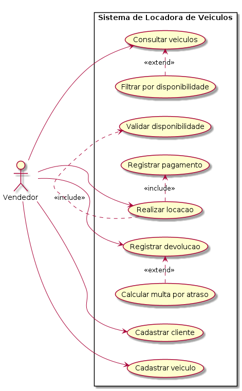
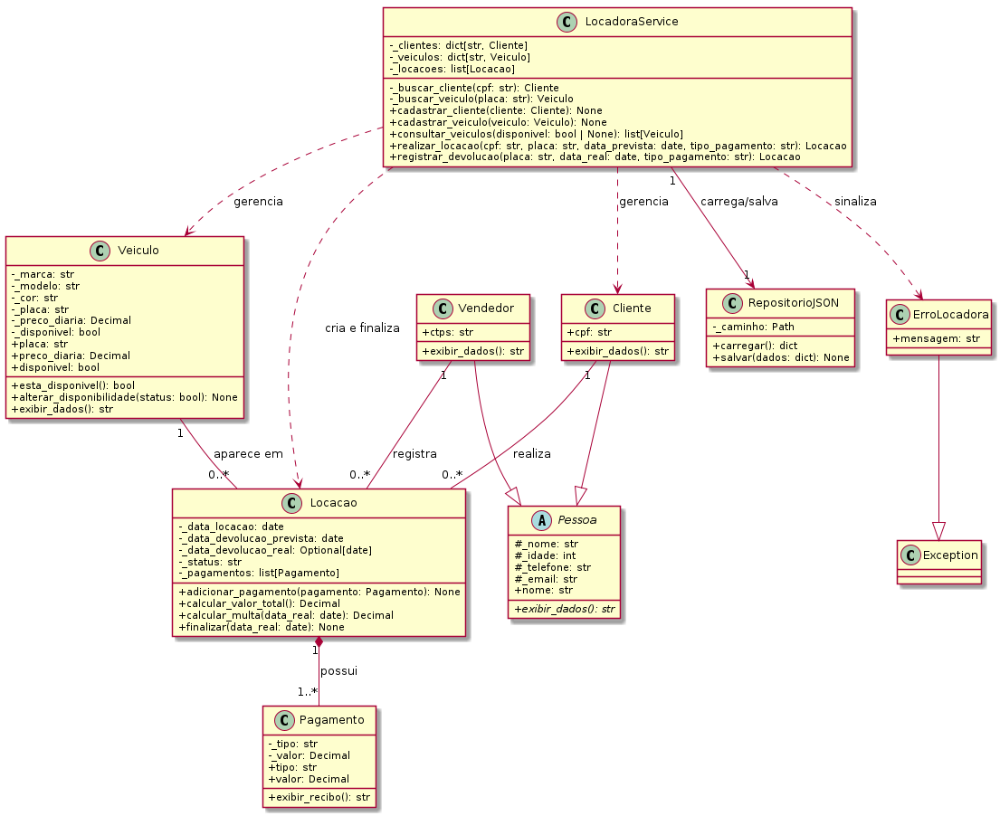
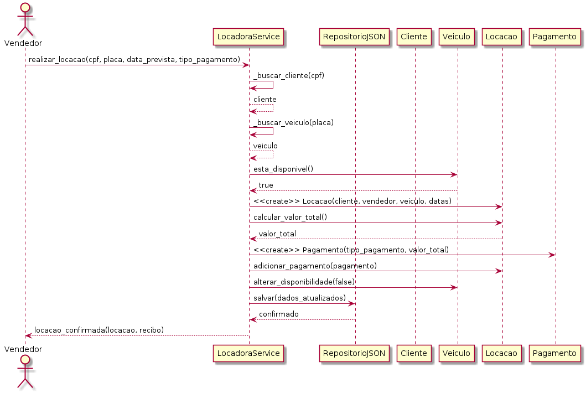
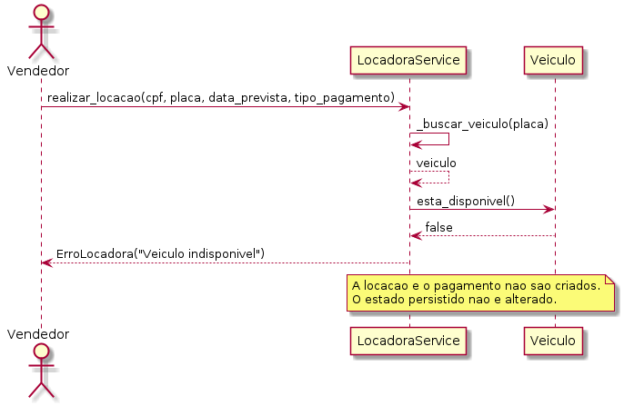
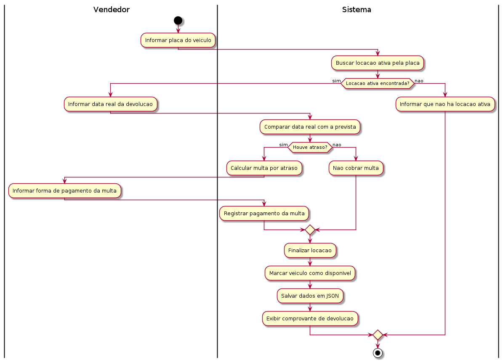

# Apresentação dos diagramas UML

Esta página reúne os diagramas em PNG, descreve o que cada um representa e explica os principais símbolos utilizados.

## Mapa dos símbolos

| Símbolo | Significado |
|---|---|
| Pessoa (ator) | Alguém ou algo externo que interage com o sistema; aqui, o vendedor. |
| Elipse | Uma funcionalidade do sistema em um diagrama de casos de uso. |
| `<<include>>` | Um caso de uso sempre inclui o comportamento indicado. |
| `<<extend>>` | Um comportamento opcional ou condicionado pode complementar outro caso de uso. |
| `+` / `-` / `#` | Membros públicos, privados e protegidos no diagrama de classes. |
| `--|>` | Herança: a classe antes da seta herda da classe apontada. |
| `*--` | Composição: relação forte de parte e todo; neste modelo, a locação possui pagamentos. |
| Seta entre participantes | Uma chamada ou mensagem enviada durante a sequência. Seta tracejada representa retorno. |
| Caixa de ação | Uma atividade executada durante o processo. |
| Losango | Uma decisão que divide o fluxo conforme uma condição. |
| Faixas `Vendedor` / `Sistema` | Indicam quem é responsável por cada atividade. |

## 1. Casos de uso

Apresenta as funcionalidades disponíveis ao vendedor: cadastrar clientes e veículos, consultar veículos, realizar locações e registrar devoluções. Também mostra validações e ações relacionadas, como registrar pagamento e calcular multa.

**Fonte editável:** [casos-de-uso.puml](../fontes/casos-de-uso.puml)

## 2. Diagrama de classes

Mostra a estrutura estática do sistema e as relações entre pessoas, clientes, vendedores, veículos, locações e pagamentos. Também inclui o serviço da locadora, o repositório JSON e a exceção de negócio. Os sinais de visibilidade indicam se atributos e operações são públicos, privados ou protegidos.

**Fonte editável:** [classes.puml](../fontes/classes.puml)

## 3. Diagramas de sequência

Diagramas de sequência mostram a ordem das mensagens trocadas entre o vendedor e os componentes do sistema ao longo de uma operação.

### 3.1 Locação realizada com sucesso

Mostra o fluxo em que o sistema encontra o cliente e o veículo, confirma a disponibilidade, calcula o valor, registra o pagamento, atualiza a disponibilidade e persiste os dados.

**Fonte editável:** [sequencia-locacao-sucesso.puml](../fontes/sequencia-locacao-sucesso.puml)

### 3.2 Veículo indisponível

Mostra o fluxo alternativo em que o veículo não está disponível. O sistema informa o erro e não cria a locação nem o pagamento, mantendo os dados persistidos sem alteração.

**Fonte editável:** [sequencia-locacao-indisponivel.puml](../fontes/sequencia-locacao-indisponivel.puml)

## 4. Diagrama de atividades — devolução

Descreve as etapas da devolução e separa as responsabilidades entre vendedor e sistema. O fluxo verifica se existe uma locação ativa, compara as datas e, se houver atraso, calcula e registra a multa antes de finalizar a locação e liberar o veículo.

**Fonte editável:** [atividades-devolucao.puml](../fontes/atividades-devolucao.puml)
